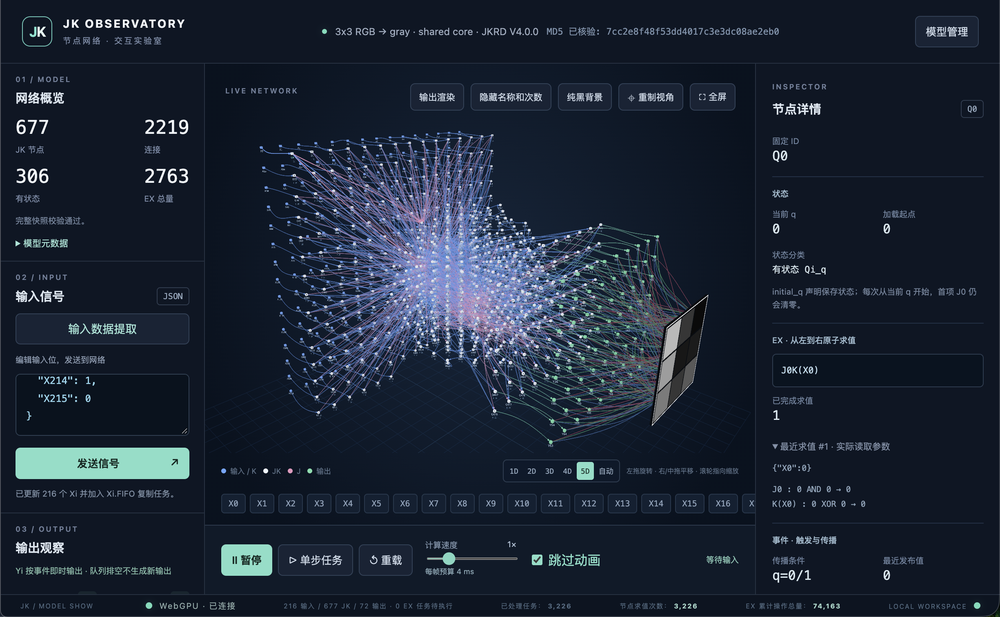

# ModelShow V3.0.0


规则与设计统一以 [JK 项目的 JKRD V4.0.0](../JK/docs/JKRD.md) 为准，依赖入口见 [JK_SOURCE.json](docs/JK_SOURCE.json)。本项目只接受 V4.0.0 完整快照，不兼容或自动迁移旧版。具体实现与恢复边界见 [模型格式与执行](docs/model-format.md)，历史报告保留原日期和证明范围。

ModelShow 是自定义 JK 节点网络的执行与 3D 展示工具。支持 FIFO 执行追踪、节点详情、六种布局、图片像素输入、RGB 输出画板和共享模型池。前端使用原生 HTML/CSS、JavaScript ES modules、Three.js WebGPU 与 Vite。

## 本地运行

需要 Node.js 22.12+、pnpm，以及支持 WebGPU 的浏览器。浏览器无法初始化WebGPU时显示提示，不切换到WebGL。

```sh
pnpm install
./tools/dev.sh
```

默认打开终端输出的 `http://127.0.0.1:5173/`。需要共享模型池时，在另一终端运行 `./tools/dev.sh api`；未连接后端仍可进行本页导入、模型切换和下载。

```sh
./tools/dev.sh build
./tools/dev.sh preview
```

构建后也可运行 `./tools/dev.sh serve`，在本地提供前端及持久模型池。命令区别和文件位置见[开发维护](docs/development.md)，线上Worker与R2说明见[模型池与托管](docs/hosting.md)。本地命令不公开发布网站。

## 使用入口

- **模型管理**：导入、切换、编辑和下载；无效JSON 保留当前有效模型。共享临时模型公开管理，永久模型入池/删除需管理员口令。
- **发送与播放**：输入Xi JSON后发送，支持暂停、单步、倍速和跳过动画；查看完整虚拟队列、最近60条历史及节点求值步骤。
- **图片输入**：基础图片或本地PNG/JPEG/WebP提取像素并填入Xi，填入后需单独发送。
- **输出渲染**：将Yi组合为RGB灯通道；灯编辑为草稿，点击“应用到此灯”保存，画板配置以独立 JSON 导入/导出，只包含已应用配置。

默认图片选区3×3；新画板3×3、关闭、缩放3倍；布局5D、播放1倍且跳过动画。画板文件必须显式提供 scale。

## 项目结构

```text
html/                   页面、配置、资源与服务入口
  index.html main.js config.js style.css
  example.json favicon.ico b1.png b2.png
  server/               本地服务、Sites Worker与R2
src/                    功能模块
  jk/                   执行器、校验、快照、模型池数据
  ui/                   输入、输出、模型管理、播放控制
  scene/                3D 场景、布局、相机、绘制
tools/                  开发与构建工具
  dev.sh vite.config.js build.mjs
tests/                  run.mjs、分组测试、fixtures、helpers和bench
docs/                   JK_SOURCE.json、使用、契约、维护与验证记录
```

| 要修改什么 | 入口 |
| --- | --- |
| 界面结构、固定选项、变长行模板 | `html/index.html` |
| 样式、颜色、尺寸与窄屏适配 | `html/style.css` |
| 默认值与限制 | `html/config.js` 的只读 `APP_CONFIG` |
| 交互与数据更新 | `html/main.js` 及 `src/` 对应功能目录 |
| 模型执行语义、校验与快照 | `src/jk/` |
| 输入、输出、模型管理与播放控制 | `src/ui/` |
| 3D 场景、布局与画板绘制 | `src/scene/` |
| 模型池服务和R2协议 | `html/server/` 与 `src/jk/model-pool.js` |

JS只克隆HTML模板、填值和绑定事件；选中/异常通过class，固定外观归CSS。具体动态变量、控制器生命周期、配置职责见[开发维护](docs/development.md#界面维护边界)。

## 文档与验证

- [模型格式与执行语义](docs/model-format.md)：V4 校验、双队列任务、状态、输出事件和快照恢复。
- [操作说明](docs/usage.md)：播放、图片输入和画板配置格式。
- [场景与布局](docs/rendering.md)：1D～5D/自动、相机、全屏与渲染边界。
- [逐文件清理记录](docs/project-file-audit.md)：每个项目文件的保留、移动或移出理由。
- [开发维护](docs/development.md)：目录职责、构建预览、定向测试与性能入口。
- [模型池与托管](docs/hosting.md)：共享管理、离线恢复、HTTP版本和Sites R2存储。
- [V4 对齐记录](docs/validation/jkrd-v4-2026-10-12.md)：2026-10-12 的 V4 差异、定向测试与 Chrome 检查，不包含后续目录调整的验证。
- [历史 JK 空间对齐记录](docs/jk-space-alignment-2026-10-02.md)：2026-10-02 的改动、199 项相关功能测试及 Chrome 检查范围。

按改动范围运行相关测试，前端验收使用外部 **Chrome**。不默认跑全流程回归，不自动提交Git或公开发布。历史验证记录保留执行日期与证明范围，不代表当前工作区全量验收。

## 口令在 html/server/.env.sites 里的 MODEL_POOL_TOKEN 内容。